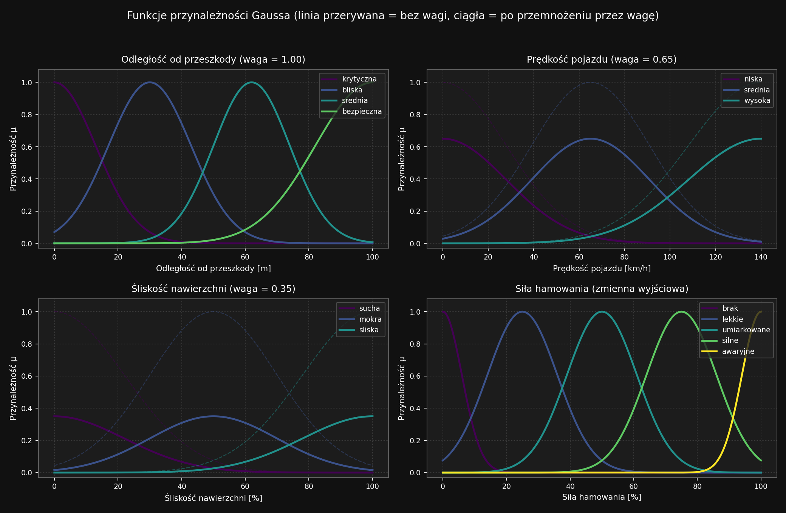
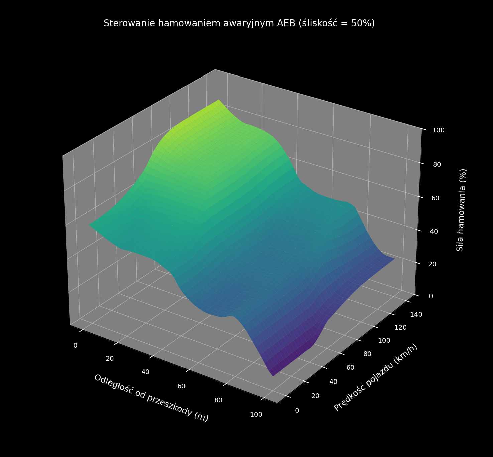
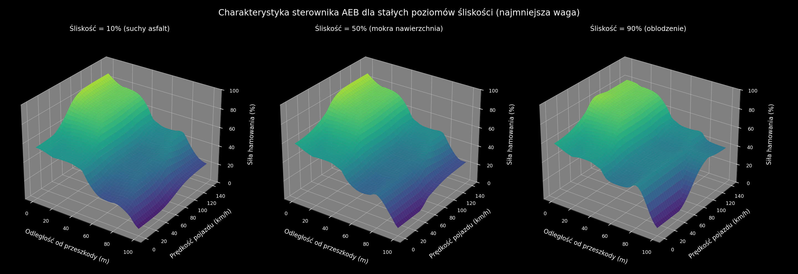
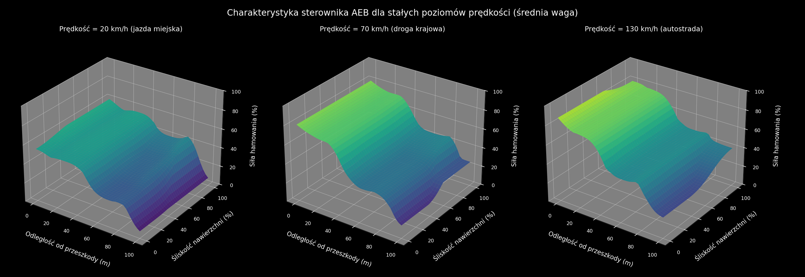
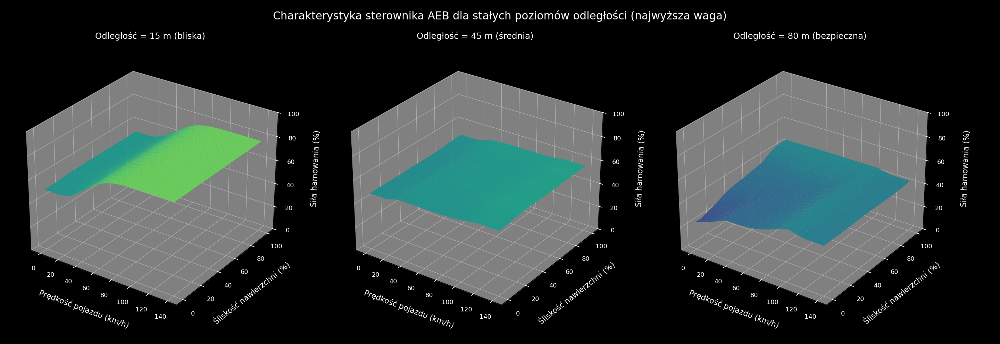

# Lab 6 — Sterownik rozmyty systemu awaryjnego hamowania (AEB)

Implementacja **od zera** (bez użycia zewnętrznych bibliotek logiki rozmytej) sterownika **Autonomous Emergency Braking (AEB)** opartego na wnioskowaniu Mamdaniego w czystym Pythonie z wykorzystaniem `numpy` (obliczenia wektorowe i siatka) oraz `matplotlib` (wizualizacje 3D).

## Założenia i zmienne lingwistyczne

Sterownik płynnie reguluje siłę hamowania pojazdu (`0–100%`) na podstawie trzech cech środowiskowo-ruchowych o zróżnicowanych wagach:

| Zmienna | Zakres | Waga cechy | Zbiory rozmyte (funkcje Gaussa) |
| --- | --- | --- | --- |
| **Odległość od przeszkody** (`odleglosc`) | `0–100 m` | **1.00** *(najwyższa)* | `krytyczna`, `bliska`, `srednia`, `bezpieczna` |
| **Prędkość pojazdu** (`predkosc`) | `0–140 km/h` | **0.65** *(średnia)* | `niska`, `srednia`, `wysoka` |
| **Śliskość nawierzchni** (`sliskosc`) | `0–100 %` | **0.35** *(najmniejsza)* | `sucha`, `mokra`, `sliska` |
| **Siła hamowania** *(wyjście)* | `0–100 %` | — | `brak`, `lekkie`, `umiarkowane`, `silne`, `awaryjne` |

## Architektura algorytmu (`fuzzy_controller.py`)

1. **Funkcje przynależności**: gaussowskie `gaussian_mf(x, mean, sigma)` (w module dostępna jest także uogólniona funkcja dzwonowa `gbell_mf`).
2. **Ważenie cech**: realizowane bezpośrednio przez przemnożenie wartości funkcji przynależności przez wagę zmiennej wejściowej:
   $$\mu_{\text{ważona}}(x) = w_i \cdot \mu(x)$$
3. **Blok rozmywania (`fuzzify`)**: wyznaczenie ważonych stopni przynależności dla wartości ostrych.
4. **Blok wnioskowania Mamdaniego (`infer`)**:
   - warstwowa baza 23 reguł rozmytych (reguły bazowe dla odległości, reguły z prędkością oraz reguły korygujące dla śliskości nawierzchni),
   - agregacja przesłanek operatorem `min` (T-norma),
   - implikacja Mamdaniego operatorem `min` (przycięcie zbioru wyjściowego),
   - agregacja wniosków operatorem `max` (S-norma).
5. **Blok wyostrzania (`defuzzify`)**: metoda środka ciężkości (Centroid / Center of Gravity):
   $$y^* = \frac{\sum y \cdot \mu_{\text{agg}}(y)}{\sum \mu_{\text{agg}}(y)}$$

## Uruchomienie

```bash
cd lab6
python3 main.py          # zapisuje wszystkie wykresy do lab6/plots/
python3 main.py --show   # dodatkowo otwiera okna wykresów interaktywnie
```

Wymagania: `numpy`, `matplotlib` (zob. [requirements.txt](requirements.txt)).

## Analiza wrażliwości (weryfikacja hierarchii wag)

Pomiar średniego rozstępu siły hamowania na siatce `15×15×15` przy zmianie pojedynczej cechy:

- **Odległość** (waga `1.00`): **55.73 pp**
- **Prędkość** (waga `0.65`): **17.72 pp**
- **Śliskość** (waga `0.35`): **4.81 pp**

## Wygenerowane charakterystyki

### Funkcje przynależności


### Przykładowa powierzchnia 3D (śliskość = 50%)


### Charakterystyki 3D dla ustalonych poziomów każdej z cech






